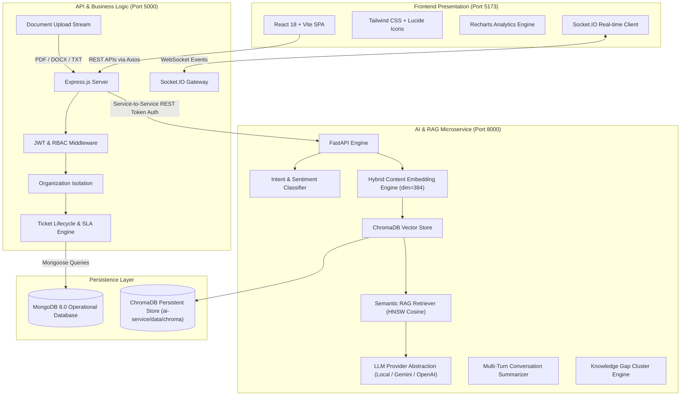
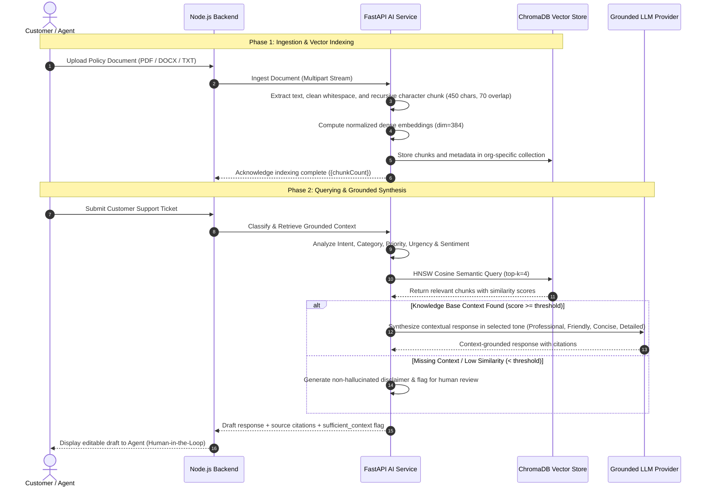

# ResolveAI – System Architecture & Technical Specifications

ResolveAI is an enterprise-grade Intelligent Customer Support Platform engineered with a decoupled microservice architecture: a React Single Page Application (SPA), a Node.js Express API Gateway, a Python 3 FastAPI Generative AI service, a MongoDB operational database, and a ChromaDB persistent vector store.

---

## 1. High-Level Architectural Diagram

---

## 2. Retrieval-Augmented Generation (RAG) Workflow

---

## 3. Data Isolation and Multi-Tenancy

Each organization in ResolveAI operates with complete logical data isolation:
1. **Database Level**: Every document in MongoDB (`Ticket`, `Message`, `KnowledgeDocument`, `AIAnalysis`, `GeneratedResponse`, `Escalation`, `AuditLog`) is indexed by `organization: ObjectId`. Middleware strictly injects `req.orgId` derived from verified JWT tokens, preventing cross-tenant leakage.
2. **Vector Database Level**: ChromaDB collections are partitioned per organization (`org_<slug>`). Vector searches are restricted to the calling tenant's isolated collection.
3. **Role-Based Access Control (RBAC)**:
   - **Admin**: Full platform management, user promotion, document upload/deletion, escalation configuration.
   - **Supervisor**: Ticket queues, reassignments, escalation resolution, agent performance auditing.
   - **Support Agent**: Ticket triage, AI suggested draft response editing, approval, and sending.
   - **Customer**: Ticket submission, conversation tracking, and thread replies.
